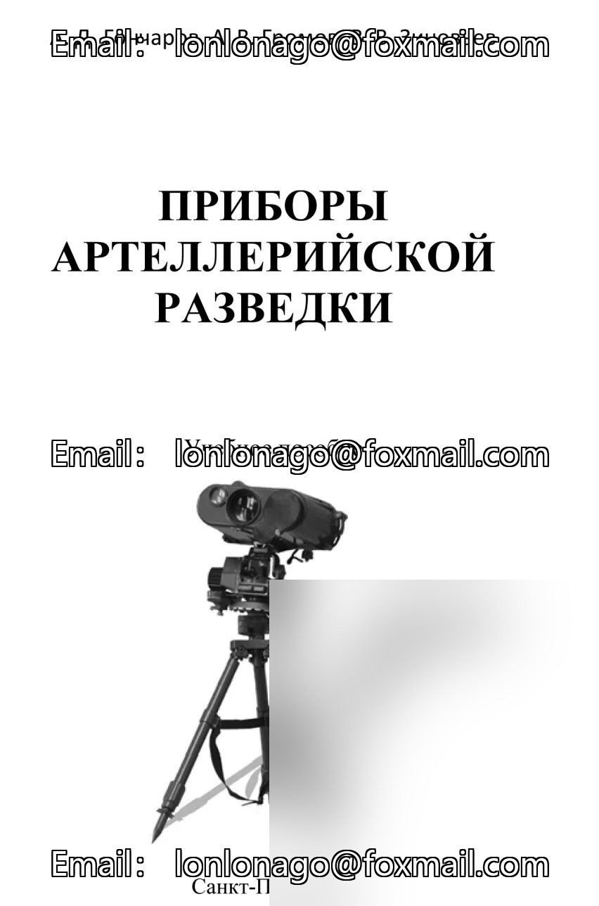
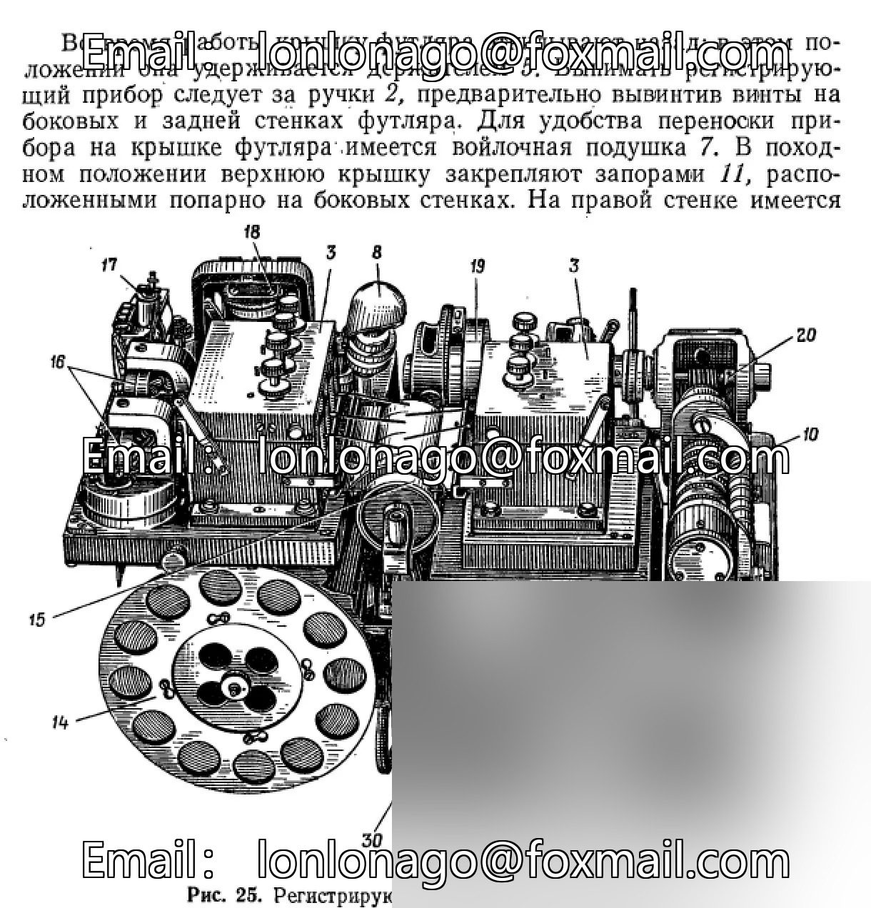
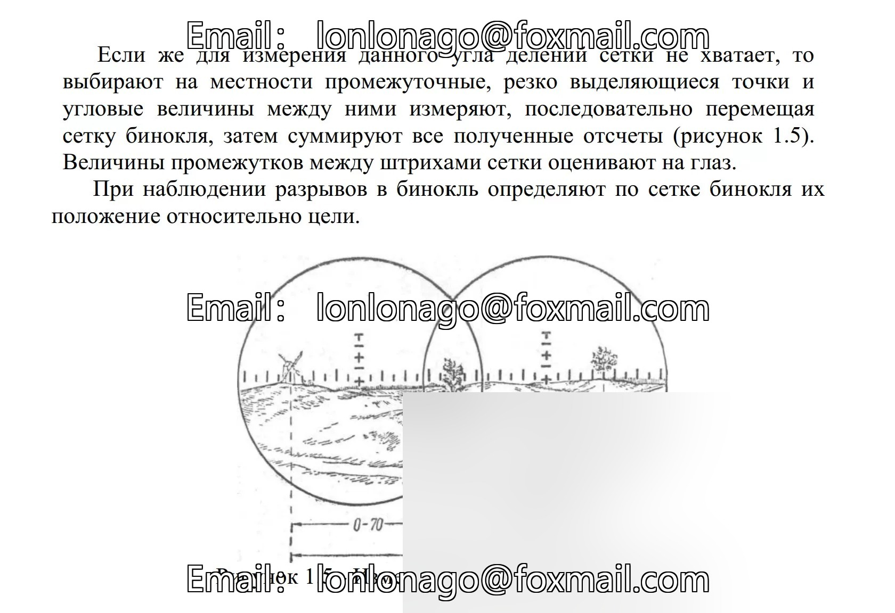
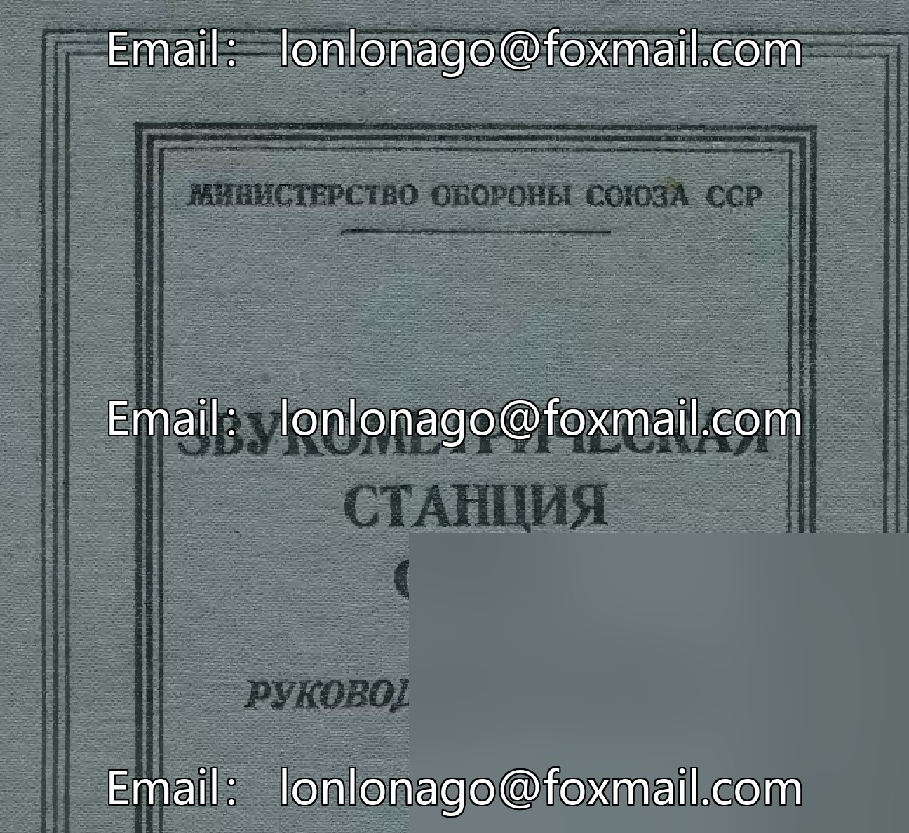
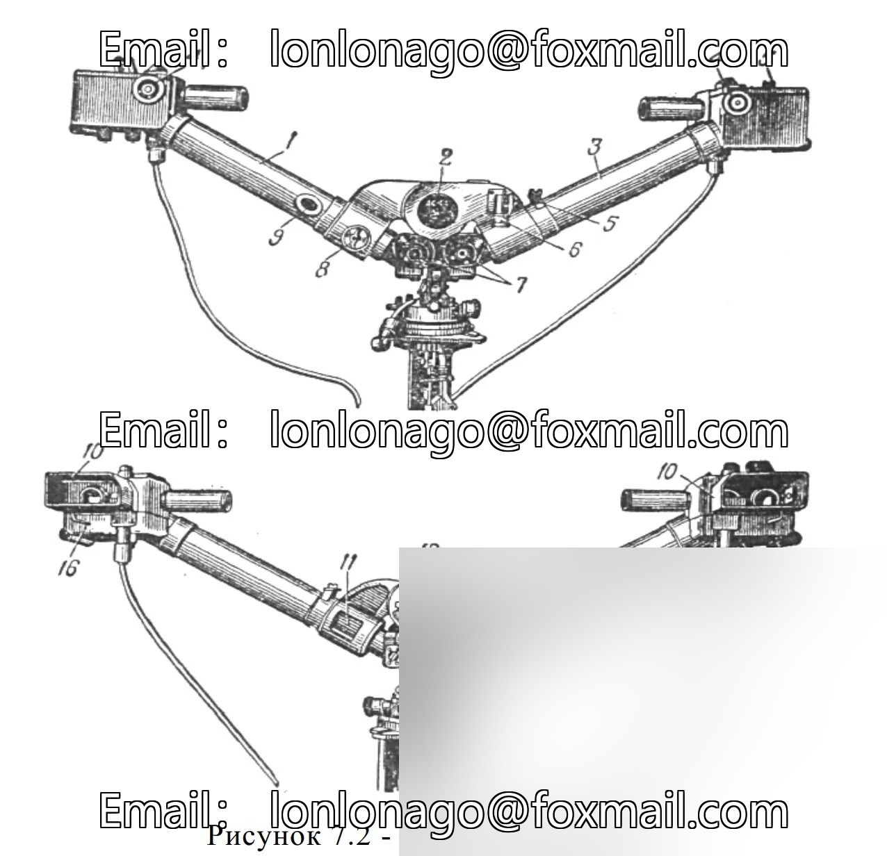
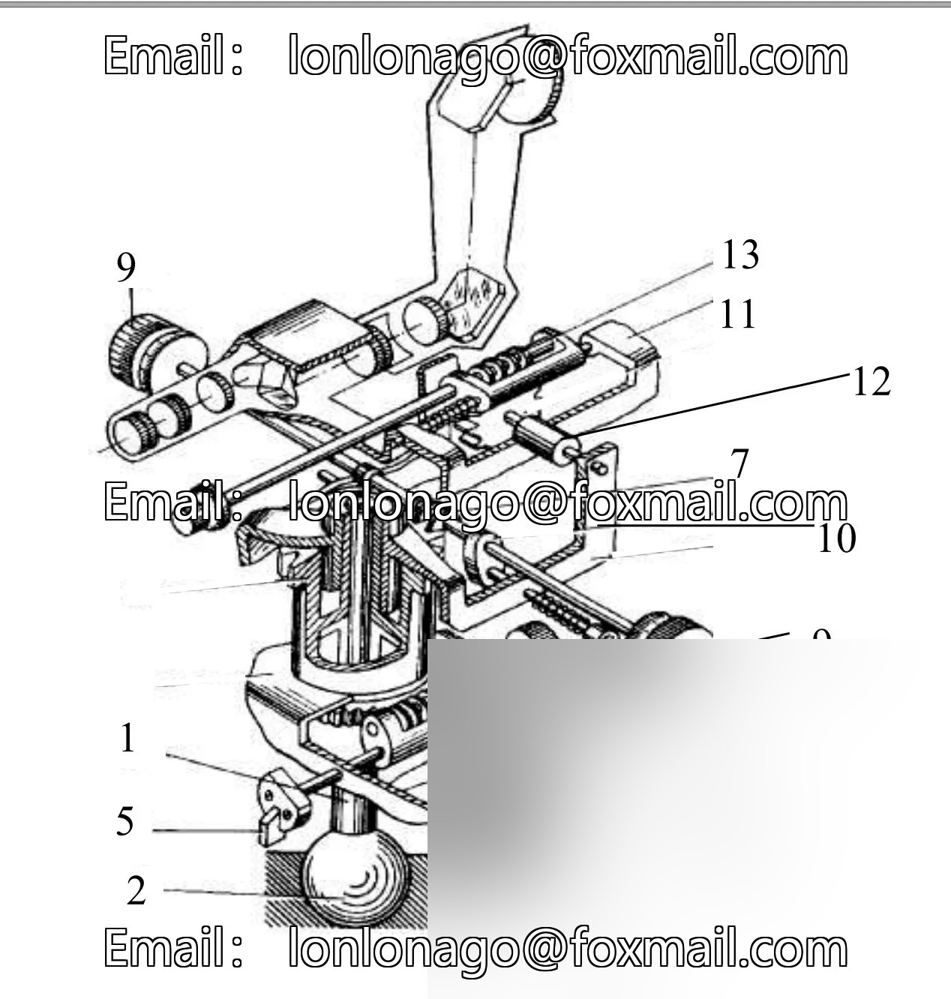

# Russia/USSR military reconnaissance technology archive

## Body

Collection of Russian/Soviet military reconnaissance technology archives,
priced at separate copy prices
covering the development journey from World War I airballistic observation to modern digital reconnaissance equipment.
1. Military reconnaissance technology literature catalog
《Military Observation Balloon (1917)》
《Artillery Acoustic Reconnaissance (1993)》
《Taranov: Artillery Acoustic Reconnaissance (1957)》
《Artillery Reconnaissance (1971)》
《Artillery Sound Reconnaissance (1948)》
《Guide to Artillery Reconnaissance Methods: Artillery Squad Reconnaissance Organization and Implementation (2016)》
《Red Army Artillery Order: Artillery Instrument Reconnaissance · Part VI (1943)》
《Artillery Acoustic Reconnaissance Order (1965)》
《Artillery Optical Reconnaissance Order (1970)》

《Ground Firetrain Reconnaissance Manual (1960)》
《Torpedo Firetrain Visual Reconnaissance (1955)》
《Torpedo Firetrain Optical Reconnaissance Division Combat Guide (2002)》
《1938-type Improved Acoustic Station Service Manual (1947)》
《SCTZ-6 Acoustic Station Service Manual (1958)》
《PRP-4 (1/V121) Mobile Reconnaissance Station Combat Use Description (2006)》
《Torpedo Brigade Weather Station Work Regulations (1985)》
《Range Finder-Follow Target Textbook (1979)》
《Torpedo Reconnaissance Instrument Textbook (2012)》
2. Document characteristics
The content is comprehensive, organizing the development of military reconnaissance technology from early balloon reconnaissance to modern digital reconnaissance systems from an overall perspective.

Suitable for military enthusiasts, professional researchers, and military historical researchers.
are replicable, and they are not refunded upon sale.

The collection covers the development from early balloon reconnaissance to modern digital reconnaissance equipment, including military reconnaissance technical documents and archives with a separate pricing indicated.

<!-- AI_ENRICHED -->

## Images

## Payment

Here is a pay link on Stripe ( https://buy.stripe.com/3cs8yP7sY87d0vu9AB ). Please contact me lonlonago@foxmail.com after funding $89, and I will send you a complete data files , thank you!

